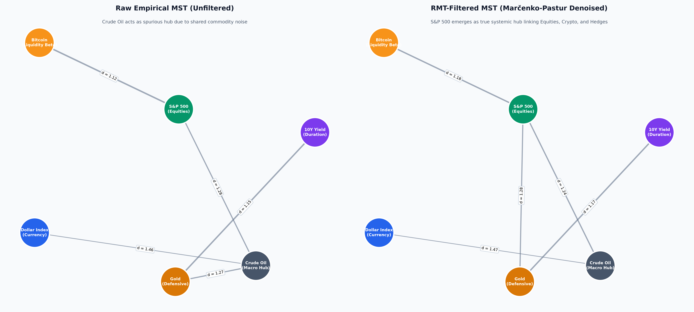
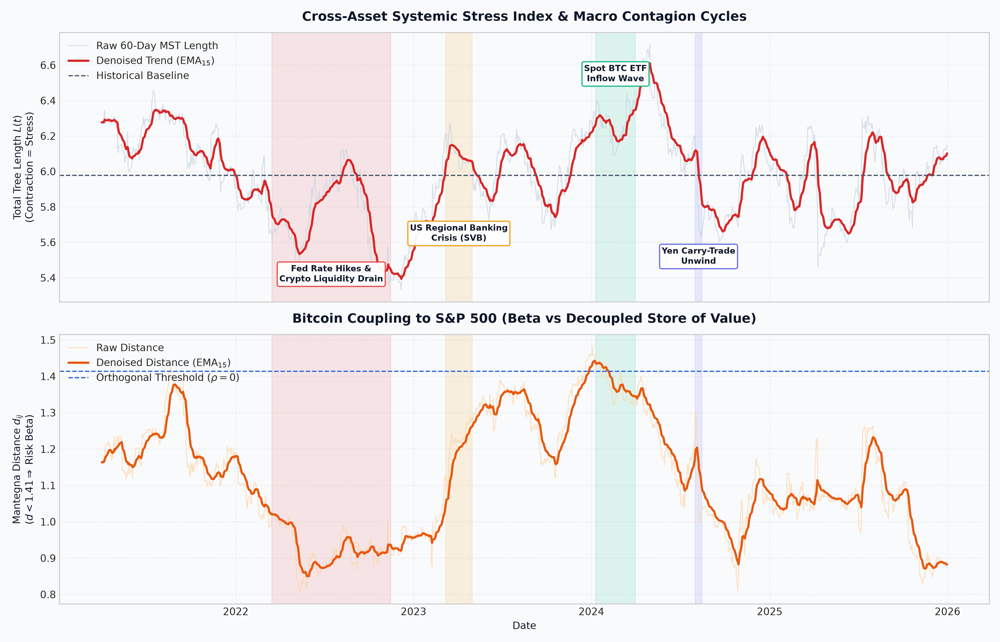

---

# Quantitative Cross-Asset Network Topology & Systemic Risk Analysis

An automated pipeline and statistical physics framework evaluating cross-asset market fragility, topological regime shifts, and systemic contagion across traditional macro assets and cryptocurrencies.

---

## Executive Summary

Standard Pearson correlation networks often misrepresent market structures due to finite-sample noise ($T < \infty$) and transitivity violations. This project implements **Random Matrix Theory (RMT)** to isolate genuine structural modes from the Marčenko-Pastur noise bulk. By tracking rolling Minimum Spanning Trees (MST) over time, the model generates an empirical **Systemic Stress Index ($L(t)$)** that anticipates liquidity contractions and identifies regime shifts in Bitcoin's coupling to equity beta.

---

## 1. Topological Hub Identification: Raw vs. Denoised Networks

* **Spurious Centrality Demotion:** In the raw correlation network, Crude Oil falsely appears as a degree-3 systemic hub linking equities, gold, and currencies ($d = 1.27$).
* **Structural Market Anchor:** Applying Marčenko-Pastur eigenvalue cleaning separates genuine signals from empirical noise, breaking the spurious Oil–Gold link and establishing the **S&P 500 as the true systemic hub** ($d = 1.28$ to Gold).
* **Structural Invariants:** The monetary duration corridor (`Gold <--> US 10Y Treasury`, $d \approx 1.16$) and petrodollar baseline (`Crude Oil <--> US Dollar Index`, $d \approx 1.47$) remain invariant before and after denoising, confirming fundamental macroeconomic dependencies.
---

---

## 2. Dynamic Contagion & Liquidity Stress Index

* **Systemic Liquidity Contractions $L(t)$:** During global liquidity drains—most notably the consecutive 2022 Fed rate hikes—cross-asset correlations surge toward $+1$, causing Mantegna distances to collapse and Total Tree Length $L(t)$ to plummet below $5.4$ (vs. $5.98$ historical mean).
* **Early-Warning Flash Dips:** Sharp V-shaped contractions reliably flagged secondary systemic shocks, including the Silicon Valley Bank (SVB) collapse and the August 2024 Yen Carry-Trade unwind.
* **Bitcoin Beta vs. Safe Haven:** Bitcoin remains anchored to the S&P 500 ($d \approx 0.85\text{–}1.18$) during tightening cycles, proving institutional market participation treats digital assets as leveraged equity beta. The only sustained decoupling occurred during the Spot ETF rollout (early 2024), where metric distance crossed the orthogonal threshold ($d > 1.41$, $\rho < 0$).
---

---

## Methodology & Mathematical Framework

### 1. Mantegna Metric Space

Because standard correlation violates the triangle inequality ($d(x, z) \le d(x, y) + d(y, z)$), correlation coefficients $\rho_{ij}$ are mapped into an ultrametric Euclidean distance space:

$$d_{ij} = \sqrt{2(1 - \rho_{ij})}, \quad d_{ij} \in [0, 2]$$

Kruskal's algorithm extracts the network's Minimum Spanning Tree (MST), reducing an $N(N-1)/2$ complete graph to $N-1$ critical structural edges.

### 2. Random Matrix Theory (RMT) Filtering

To eliminate spurious empirical correlations, the eigenvalue spectrum of the correlation matrix $\mathbf{C}$ is evaluated against the theoretical Marčenko-Pastur density:

$$\lambda_{\pm} = \sigma^2 \left(1 \pm \sqrt{\frac{N}{T}}\right)^2$$

Eigenvalues falling within the random noise bulk $[\lambda_-, \lambda_+]$ are clumped to their average $\bar{\lambda}$, preserving total matrix trace ($\text{Tr}(\mathbf{C}) = N$) while isolating the dominant Market Mode ($\lambda_1$) and Informational Modes ($\lambda_2 > \lambda_+$).

---

## Project Structure

```text
├── data/
│   └── raw/
│       └── macro_log_returns.parquet
├── figures/
│   ├── raw_vs_clean_mst.png
│   ├── market_systemic_stress_index.png
│   └── rmt_eigenvalue_spectrum.png
├── notebooks/
│   └── 01_market_mst_network.ipynb
├── src/
│   └── fetch_macro_data.py
├── requirements.txt
├── .gitignore
└── README.md

```

---

## Technical Stack

* **Language & Architecture:** Python 3.11+, Virtual Environment (`venv`), Parquet columnar storage.
* **Data Engineering:** `pandas`, `numpy`, `yfinance`.
* **Network Science & Physics:** `networkx`, `scipy` (Linear Algebra & Spectral Decomposition).
* **Visualization:** `matplotlib`, `seaborn`.

---
